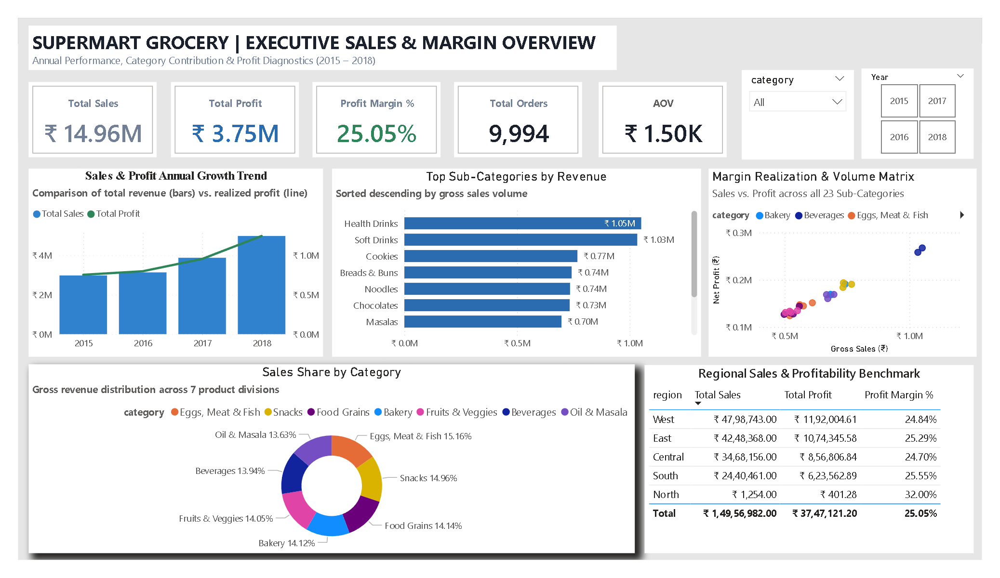
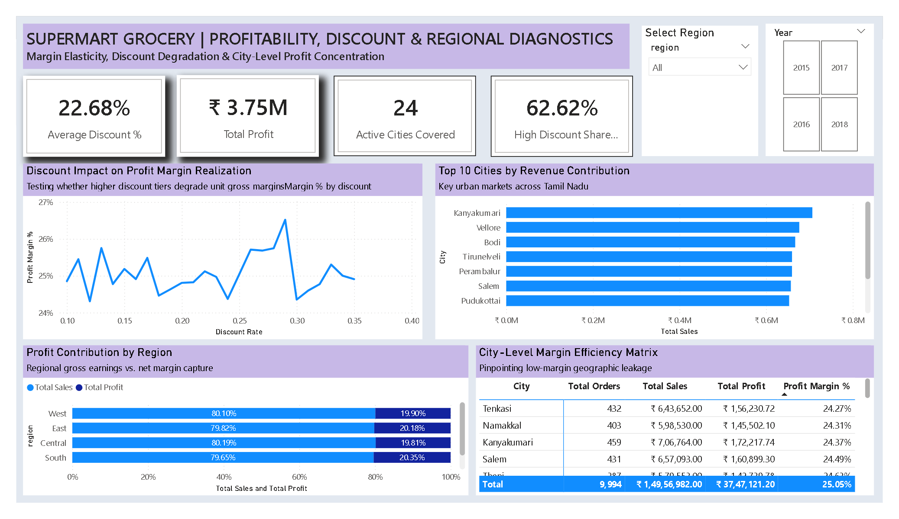

<div align="center">

# 🛒 Supermart Grocery Sales Analytics & BI Platform
### Enterprise-Grade Retail Business Intelligence, Margin Elasticity & Spatial Diagnostics

[](https://github.com/yusufehtesham29/supermart-grocery-sales-analytics)
[](https://github.com/yusufehtesham29/supermart-grocery-sales-analytics)
[](https://opensource.org/licenses/MIT)

[View Live Dashboard Preview](#-dashboard-architecture--visual-diagnostics) • [Business Insights](#-strategic-executive-insights) • [SQL Highlights](#-production-sql-queries) • [DAX Semantic Layer](#-core-dax-semantic-model)

</div>

---

## 📌 Executive Summary

This repository delivers an end-to-end retail business intelligence platform analyzing **₹14.96M** in gross sales and **₹3.75M** in net profit across the state of Tamil Nadu, India. 

The pipeline bridges raw data ingestion in **Python**, transactional database modeling in **Microsoft SQL Server**, semantic modeling in **DAX**, and an interactive 2-page decision dashboard in **Power BI**.

| Total Sales | Net Realized Profit | Operating Margin | Transaction Volume | Average Order Value | Avg Discount Rate |
| :---: | :---: | :---: | :---: | :---: | :---: |
| **₹14.96M** | **₹3.75M** | **25.05%** | **9,994** | **₹1,496.60** | **22.68%** |

---

## 📊 Dashboard Architecture & Visual Diagnostics

### Page 1: Executive Sales & Margin Overview
*Tracks multi-year top-line growth, category revenue distribution, sub-category sales rankings, and volume-to-profit matrix positioning.*

<p align="center">
  
</p>

### Page 2: Profitability, Discount & Regional Diagnostics
*Evaluates promotional margin elasticity, regional profit capture, top revenue-generating urban centers, and municipal margin leakage.*

<p align="center">
  
</p>

---

## 💡 Strategic Executive Insights

### 1. Revenue Trajectory & Profit Resiliency
* **Scale & Trajectory:** Gross revenue expanded from **₹2.98M (2015)** to **₹4.98M (2018)**—an aggregate growth rate of **+67.3%**.
* **Margin Integrity:** Net profit margins held strictly within the **24.7% – 25.3%** band across all four operating years, demonstrating that customer expansion occurred without baseline price deterioration.

### 2. Category Performance & Portfolio Distribution
* **Risk-Balanced Distribution:** The portfolio shows balanced revenue contribution across all 7 divisions:
  * **Eggs, Meat & Fish:** ₹2.27M (*15.16% share*, 25.02% margin)
  * **Snacks:** ₹2.24M (*14.96% share*, 25.39% margin)
  * **Food Grains:** ₹2.12M (*14.14% share*, 25.02% margin)
  * **Bakery:** ₹2.11M (*14.12% share*, 25.02% margin)
  * **Fruits & Veggies:** ₹2.10M (*14.05% share*, 25.25% margin)
  * **Beverages:** ₹2.09M (*13.94% share*, 25.21% margin)
  * **Oil & Masala:** ₹2.04M (*13.63% share*, 24.43% margin)
* **High-Volume Engines:** Across 23 sub-categories, **Health Drinks** (₹1.05M) and **Soft Drinks** (₹1.03M) emerged as the single-largest drivers of transactional turnover.

### 3. Promotional Elasticity & Discount Thresholds
* **Promotional Penetration:** **62.62%** of all completed orders utilized promotional discounts exceeding 20%.
* **Elasticity Findings:** Despite aggressive promotional exposure, realized net margin did not experience steep degradation (holding at **~24.2% – 25.5%**). This indicates that standard wholesale-to-retail markups adequately absorbed discount buffers.

### 4. Regional Footprint & Margin Traps
* **Core Regional Engines:** The **West** (₹4.80M sales / ₹1.19M profit) and **East** (₹4.25M sales / ₹1.07M profit) regions together account for over **60%** of total turnover.
* **Geographic Margin Traps:** High sales volume does not guarantee optimal profitability:
  * **Kanyakumari** posted the single-highest gross sales (₹706.8K) but underperformed on margin realization (**24.37%**).
  * **Tenkasi** (24.27%) and **Namakkal** (24.31%) recorded the lowest overall profit efficiency across all 24 markets.
  * In contrast, **Vellore** achieved strong volume alongside an above-average **25.73%** margin.

---

## 🛠 Repository Structure

```text
supermart-grocery-sales-analytics/
├── data/
│   ├── raw/                              # Original retail transactions dataset
│   └── processed/                        # Cleaned dataset with ISO-standardized dates
├── notebooks/
│   └── 01_data_profiling.ipynb          # Python EDA, missing value validation, type casting
├── sql/
│   ├── 01_schema_setup.sql              # Relational schema DDL, constraints & non-clustered indexes
│   └── 02_kpi_queries.sql               # Window functions, grouping sets & diagnostic queries
├── powerbi/
│   └── supermart_grocery_sales.pbix     # Production star-schema data model & reporting views
├── documentation/
│   ├── supermart_grocery_sales_dashboard.pdf
│   ├── page1_sales_margin_overview.png
│   └── page2_profit_regional_diagnostics.png
├── .gitignore
└── README.md

// Financial Aggregations
Total Sales = SUM(supermart_sales[sales])

Total Profit = SUM(supermart_sales[profit])

Profit Margin % = DIVIDE([Total Profit], [Total Sales], 0)

// Operational Metrics
Total Orders = COUNTROWS(supermart_sales)

Average Order Value = DIVIDE([Total Sales], [Total Orders], 0)

Average Discount % = AVERAGE(supermart_sales[discount])

// Promotional Diagnosis
High Discount Orders % = 
DIVIDE(
    CALCULATE(
        COUNTROWS(supermart_sales), 
        supermart_sales[discount] > 0.20
    ),
    COUNTROWS(supermart_sales),
    0
)
